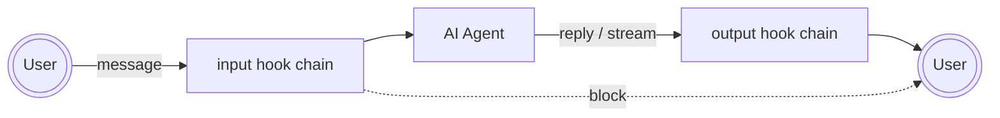
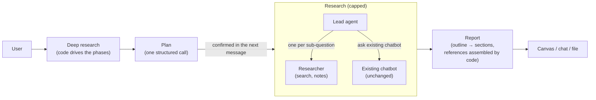
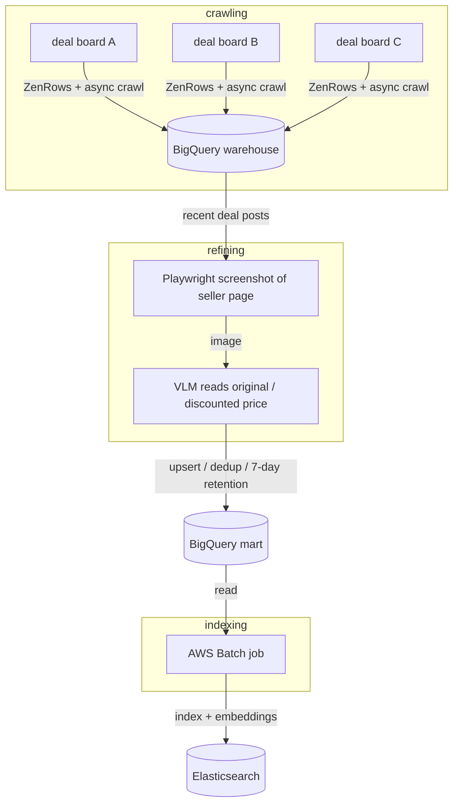
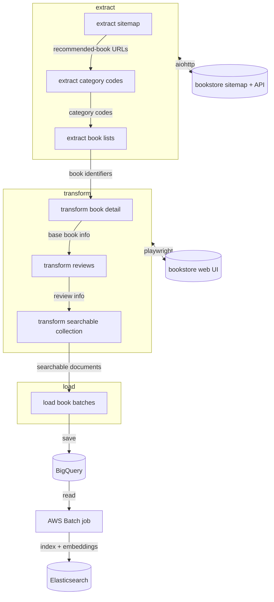
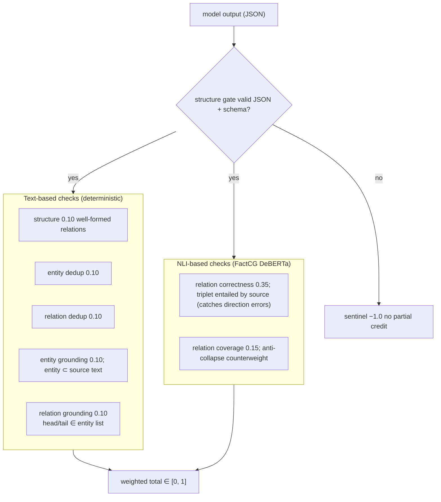
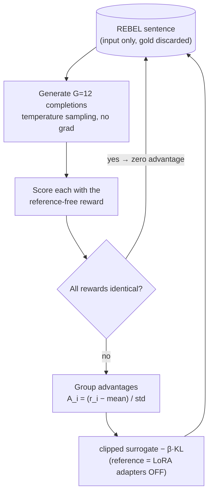
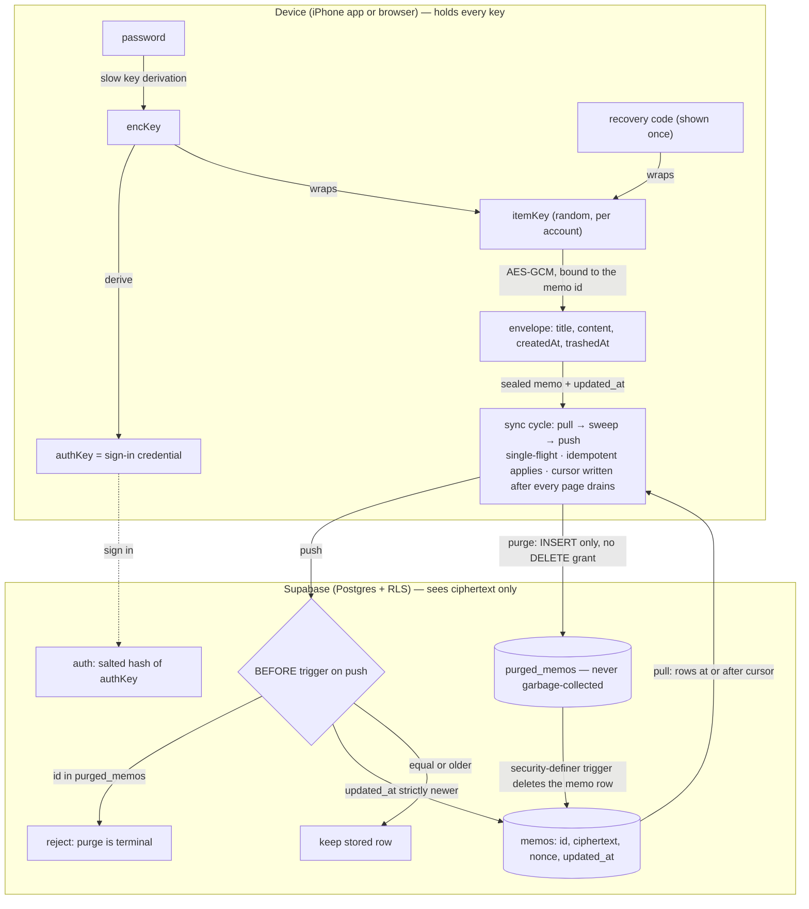

# 김원빈 (Wonbin Kim)

AI 엔지니어

타이베이 · 대만 ARC 보유 (일반 취업허가 이전 가능) · 대만 전 지역 근무 가능

[kwb0711@gmail.com](mailto:kwb0711@gmail.com) · [GitHub](https://github.com/rst0070) · [LinkedIn](https://www.linkedin.com/in/wonbin-kim-7263a7184/) · [HuggingFace](https://huggingface.co/rst0070) · [블로그](https://rst0070.github.io/notes)

## 요약

LLM 에이전트 스택 전반에 걸친 프로덕션 경험을 갖춘 AI 엔지니어입니다. 에이전트 오케스트레이션, 도구 설계, 샌드박스 기반 에이전트 거버넌스(프롬프트 인젝션 차단, 개인정보(PII) 마스킹, 출력 모더레이션), 평가 파이프라인, 멀티모달 RAG, 대화 메모리를 다룹니다.  
  

---  
  

## 기술

- **LLM / 에이전트:** LlamaIndex, LangChain, LangGraph, RAG(멀티모달), 에이전트 도구, MCP 계열 프로토콜, vLLM, 구조화 출력, 평가(DeepEval)
- **학습 / ML:** PyTorch, GRPO, QLoRA, LLM 파인튜닝, 화자 인증(Speaker Verification)
- **인프라:** AWS, GCP, Kubernetes, Docker, Terraform, Airflow, Argo Workflows, Elasticsearch, Redis, Kafka, Neo4J
- **백엔드 / 풀스택:** Python(Django, FastAPI), React / React Native, TypeScript, Java(Spring), Supabase(Postgres, RLS, 트리거), WebCrypto(AES-GCM, PBKDF2)
  
  
---
  

## 주요 성과

- **대규모 에이전트 가드레일** — AI 에이전트를 위한 gVisor 샌드박스 기반 테넌트별 미들웨어 계층(프롬프트 인젝션 차단, PII 마스킹)을 설계했습니다. **40개 이상 조직, 주당 약 6천 회 실행**에 도입되었고, 규칙은 배포 없이 전달됩니다. → [Agent Middleware](#agent-middleware)
- **메모리 시스템 전문성** — MaiAgent에서 조용히 실패하던 장기 메모리를 고쳤습니다(**8,000턴 이상에서 회상 0/4 → 4/4**, 추가 LLM 비용 없음). → [Agent Conversation Memory](#agent-conversation-memory) 이전에는 Wrtn의 MAU 500만 플랫폼에서 회상률을 **23% → 71%**로 개선했고, **Mem0(64k★)** 기여자입니다. → [Mem0 AI Assistant Memory System](#mem0-ai-assistant-memory-system)
- **프로덕션 멀티모달 RAG** — 마이그레이션 없는 오버레이 설계로 현재 **약 1만 8천 개 기업 지식베이스 중 77%**에서 교차 모달 검색을 제공합니다. → [Multimodal RAG](#multimodal-rag)
- **자율 에이전트** — 결정론적 단계 제어를 갖춘 멀티 에이전트 딥 리서치 에이전트를 출시했습니다. GPT-5 nano 같은 소형 모델에서도 끝까지 동작하며, 개발 도중의 요구사항 변경과 프로덕션 데이터 기반 개선까지 직접 맡았습니다. 기업이 자체 업무를 자동화하는 에이전트 스케줄링도 만들었습니다(**주당 9천 회 이상 실행**). → [Deep Research](#deep-research) · [Agent Schedule](#agent-schedule)
- **강화학습 파인튜닝 전 과정** — **0.8B 모델을 GRPO로 학습**(직접 구현, 참조 없는 NLI 보상)하여 지식 그래프 추출에서 **Gemini 2.5 Flash Lite 점수의 95%**에 도달했습니다. 16GB 소비자용 GPU 한 장에서 학습했습니다. → [Tiny Graph Extractor](#tiny-graph-extractor-—-sub-1b-llm-for-knowledge-graph-extraction)
- **종단간 암호화 애플리케이션** — iOS와 웹에 걸친 OffNote AI의 암호화 동기화를 설계·구현했습니다. 단방향 클라이언트 측 키 체인, 행 id에 묶인 AES-GCM 봉투, 그리고 읽을 수 있는 타임스탬프로만 중재하고 내용은 읽지 못하는 Postgres 서버로 구성됩니다. → [OffNote AI](#offnote-ai-—-on-device-note-ai-with-end-to-end-encrypted-sync-ios-web)
- **연구** — 잡음에 강인한 화자 인증에 관한 1저자 논문([arXiv](https://arxiv.org/abs/2307.10628)).
  

---
  

## 경력

### MaiAgent (AI Agent Engineer, 2025.12 - , 타이베이)

기업용 AI 에이전트 플랫폼 [maiagent.ai](https://maiagent.ai/en/about)

기존 Django + LlamaIndex 코드베이스 안에서 풀스택 AI 기능을 처음부터 끝까지 출시했습니다. AI 파이프라인, 백엔드, 프론트엔드에 걸쳐 기존 시스템의 제약 안에서 설계했습니다.

#### Agent Middleware
<details>
<summary>AI 에이전트를 감싸는 샌드박스 기반 테넌트별 훅 계층 — 40개 이상 조직, 주당 약 6천 회 실행</summary>



**목표:** 플랫폼의 모든 메시지 규칙("번체 중국어로 답하기", "경쟁사 언급 금지", PII 마스킹)은 약 5% 확률로 실패하는 프롬프트에 의존하거나, 멀티테넌트 SaaS에서 고객별로 확장할 수 없는 하드코딩된 백엔드 로직에 의존했습니다. 목표는 AI 에이전트 앞뒤에 100% 결정론적인 가로채기 계층을 두고, 테넌트별 규칙을 배포 없이 내보내는 것이었습니다.

**제약:** 현실적인 수요는 주당 약 한 개의 새 커스텀 훅이었습니다. 고객별이고, 비개발자가 작성하며, 자주 바뀝니다. 그래서 git으로 관리되고 배포를 거쳐야 하는 코드는 선택지에서 빠졌고, 신뢰할 수 없는 코드가 모든 메시지의 핫 패스에 올라가야 했습니다. 설계는 그 코드에 내부 접근 없이 애플리케이션 컨텍스트를 주고, 한 체인을 공유하는 서로 다른 작성자의 훅을 격리하며, 마스킹되지 않은 PII를 한순간도 노출하지 않고 실시간으로 스트리밍해야 했습니다.

**접근:** 훅 코드가 데이터베이스에 저장되고 gVisor 샌드박스 컨테이너에서 실행되는 미들웨어 훅 시스템을 처음부터 끝까지 설계·구현했습니다. 트리거 지점(입력 / 출력 스트리밍 / 최종 출력)마다 컨테이너 하나를 두고, 단일 docker-exec 소켓 위의 JSON 프로토콜을 유일한 통합 지점으로 삼았습니다.

- **3계층 실행 모델** — 애플리케이션 엔진, 표준 라이브러리만 쓰는 슈퍼바이저, 매번 새 네임스페이스에서 도는 훅별 핸들러. 샌드박스는 상태가 없고, 신뢰 영역이 훅별 상태 벡터를 전달하므로 서로 다른 작성자의 훅은 서로의 상태를 읽을 수 없습니다.
- **역방향 RPC**(`host_call`) — 훅이 게이트가 있는 기능 레지스트리를 통해 애플리케이션 기능(LLM 실행, 크레딧 차감)을 호출할 수 있습니다. 샌드박스는 효과의 이름만 말하고, 허용 여부와 비용은 애플리케이션이 결정합니다.
- **이중 경로 스트리밍** — 되돌아보기 꼬리를 둔 버퍼링 스트림 경로가 청크 경계에 걸친 PII 패턴을 실시간으로 잡고, 완성된 답변에 대한 최종 패스가 저장의 기준이 됩니다. 최악의 경우에도 과하게 마스킹될 뿐, 덜 마스킹되지는 않습니다.
- **계층적 격리** — gVisor로 런타임 보안, 핸들러별 새 네임스페이스로 코드 간 격리, cgroups로 자원 격리. 훅마다 컨테이너를 두는 방식은 비용이 너무 커서 배제하고, 트리거 지점 체인마다 컨테이너 하나로 정했습니다.
- **이질적인 탐지 벤더를 위한 협상형 합집합 계약**(한 곳은 약 200개 PII 범주, 다른 곳은 30개를 지원) — 비즈니스 로직은 작고 안정적인 범주 집합을 소유하고, 제공자는 자기 카탈로그를 선언하며, 선택은 설정 시점에 검증됩니다. 그래서 제공자가 바뀌어도 비즈니스 계약은 건드리지 않습니다.

**결과:**

- 플랫폼의 100개 이상 조직 중 **40개 이상 조직**이 프로덕션에서 커스텀 훅을 실행합니다 — **주당 약 6천 회 훅 실행**.
- 실제로 배포 없이 전달됩니다. 새 고객별 훅은 릴리스 주기가 아니라 관리자 화면을 통해 나갑니다.
  

**설계 글:**  
전체 사고 과정을 담은 설계 글(영문):
1. [전체 아키텍처와 샌드박스 격리 모델](https://rst0070.github.io/notes/26-05-29-middleware-of-ai-agent) — 신뢰 경계, 3계층 실행, 이중 경로 스트리밍
2. [샌드박스에서 애플리케이션으로의 역방향 RPC](https://rst0070.github.io/notes/26-06-08-rpc-from-sandbox-to-application) — 기능 레지스트리와 게이트 설계
3. [이질적인 PII/가드레일 벤더를 위한 계약](https://rst0070.github.io/notes/26-07-22-contract-heterogeneous-adapters) — 협상형 합집합 계약에 이른 과정

</details>


#### Multimodal RAG
<details>
<summary>기존 RAG 파이프라인 위에 마이그레이션 없이 얹은 멀티모달 오버레이 — 약 1만 8천 개 기업 지식베이스의 77%에서 이미지 수집, 교차 모달 검색, 이미지 기반 답변</summary>

**목표:** 요구사항은 "RAG가 이미지를 지원하게 해 주세요"라는 추상적인 한 문장으로 왔습니다. 플랫폼의 이미지 처리는 채팅 첨부가 전부였고, 수집도, 검색도, 이미지를 고려한 생성도 없었습니다. 저는 이를 구체적인 종단간 계약으로 정리했습니다. 지식베이스는 이미지(단독이든 문서에 포함된 것이든)를 수집하고, RAG 챗봇과 에이전트형 챗봇 모두 추론 시 이를 사용합니다. 별도 모드가 아니라 텍스트와 같은 설정 아래에서요.  
  
**제약:**  
- **텍스트 전용 LlamaIndex:** 코드베이스는 LlamaIndex에 깊이 결합되어 있는데, LlamaIndex의 핵심 추상화에는 이미지 노드라는 개념이 없습니다. 응답 합성기는 검색된 모든 노드를 텍스트 문자열로 평탄화하고, 리랭커는 텍스트 내용을 가정하며, 에이전트 프레임워크는 도구 결과를 텍스트로만 반환합니다. 이미지는 어디서도 요란하게 실패하지 않고, 각 계층에서 **조용히 제거**됩니다. 스택을 다시 쓰는 것은 선택지가 아니었기에, 모든 수정은 기존 LlamaIndex 클래스를 정밀하게 확장하는 방식이어야 했습니다.
- **"같은 인덱스" 지침:** 처음 설계는 이미지 벡터용 별도 Elasticsearch 인덱스를 썼지만, 방향은 "단순하게"였습니다. 이미지 데이터는 텍스트 노드와 **같은 인덱스**에 있어야 하고, 같은 수집/삭제/저장 파이프라인을 거쳐야 하며, 마이그레이션이 없어야 했습니다.
- **같은 설정, 우아한 성능 저하:** 멀티테넌트 현실에서는 어떤 지식베이스는 멀티모달이 아닌 임베딩 모델을, 어떤 챗봇은 멀티모달이 아닌 LLM을 씁니다. 기존 플랫폼은 이미지를 만나면 하드 에러를 던지거나 조용히 다른 LLM 호출 경로로 바꿨습니다. 기능은 우아하게 성능이 저하되는 **하나의 코드 경로**여야 했습니다. 스택이 지원하면 이미지를 쓰고, 지원하지 않으면 깔끔하게 건너뛰며, 테넌트별 분기는 없습니다.
  
**접근:** 멀티모달 처리를 기존 텍스트 파이프라인 위의 오버레이로 도입했습니다. 모든 계층에서 이미지가 있고 연결된 구성 요소가 이를 지원할 때만 활성화되고, 그렇지 않으면 원래 텍스트 경로가 그대로 실행됩니다.  
- **작은 요령을 쓴 인덱싱:** 같은 인덱스 지침은 검색도 제약합니다. *기존* 리트리버 스택이 이미지 결과를 내야 하는데, LlamaIndex는 그 경로에서 이미지를 지원하지 않습니다. 그래서 이미지는 `node_type='image'` 태그를 단 평범한 텍스트 노드로 인덱싱되고, 임베딩은 멀티모달 모델이 공유 벡터 공간에 미리 생성합니다. 기존 인덱싱, 검색, 삭제 로직은 수정 없이 동작하고, 하위 계층은 태그만으로 이미지를 알아보며, 하나의 쿼리 경로가 네 가지 교차 모달 모드(텍스트→텍스트, 텍스트→이미지, 이미지→텍스트, 이미지→이미지)를 모두 제공합니다.
- **기능으로서의 이미지 수집:** 플랫폼은 이미 이미지를 포함할 수 있는 여러 문서 형식(PDF, Office 등)을 파싱하고 있었으므로, 이미지 추출을 새 파이프라인이 아니라 기존 문서 리더에 섞어 넣는 기능으로 추가했습니다. 활성화 여부는 하드코딩된 타입 검사가 아니라 **어댑터 연결 시점**에 정해집니다. 리더가 연결된 지식베이스의 임베딩 모델에 멀티모달인지 묻고, 그렇다면 이미지 노드를 내보내고, 아니면 아무것도 내보내지 않습니다. 텍스트 추출은 어느 쪽이든 똑같이 동작합니다.
- **커스텀 이미지 구조를 실어 나르도록 LlamaIndex 기본 엔진을 패치:** 두 추론 경로 모두 설계상 이미지를 버립니다. 채팅 엔진의 합성기는 검색된 모든 노드를 텍스트 문자열로 평탄화하고, 에이전트 프레임워크는 도구 결과를 텍스트로만 반환합니다. 두 곳을 모두 확장했습니다. 실제 이미지 블록으로 LLM 메시지를 만드는 커스텀 합성기, 그리고 도구 결과 이미지를 스크래치패드에 주입하는 에이전트 측 처리(예산 제한이 있고, 메모리 저장 전에 정리됨)입니다. 각 패치는 태그된 이미지 노드가 실제로 나타나고 LLM이 멀티모달일 때만 동작합니다. 그렇지 않으면 기본 경로가 실행되고, 이미지는 로그 한 줄과 함께 건너뜁니다. 에러도, 사용자에게 다른 동작도 없습니다.
  
**결과:**  
- **기업 지식베이스의 77%(17,818개 중 13,716개)가 이제 멀티모달 파이프라인에서 동작합니다.** 오버레이 설계가 일부의 선택 기능이 아니라 프로덕션의 대다수를 지원합니다. 나머지 텍스트 전용 지식베이스는 이미지 로직이 잠든 채 같은 코드 경로를 실행합니다. 우아한 성능 저하 설계가 프로덕션에서 두 집단을 모두 감당하고 있습니다.
- 기업 고객이 **처음으로 지식베이스에 이미지를 올리고 검색**할 수 있게 되었습니다. RAG 챗봇과 에이전트형 챗봇 모두에서, 교차 모달 검색(텍스트→이미지, 이미지→텍스트, 이미지→이미지)이 최종 사용자와 에이전트의 도구로 제공됩니다.
- 이미지는 실패 사례(하드 에러나 조용히 달라지는 LLM 호출 경로)에서 **챗봇 설정 변경 없이 지원되는 모달리티**가 되었고, 인덱스 마이그레이션 없이 출시되었습니다.

<details>
<summary>상세</summary>

- 전체 파이프라인 — 세 개의 조건부 게이트가 이 설계를 오버레이로 만듭니다. 텍스트는 항상 원래 경로로 흐르고, 이미지 로직은 모든 게이트를 통과할 때만 동작합니다

    ```mermaid
    flowchart TB
        subgraph ING["Ingestion — existing document pipeline + image capability"]
            direction LR
            UP["Upload<br/>documents (PDF, Office, …)<br/>or standalone images"] --> RD["Existing document parsers<br/>(unchanged)"]
            RD --> TXT["text chunks<br/>indexed as before"]
            RD --> G1{"does this knowledge base's<br/>embedding model support images?<br/>(checked when connected, not hardcoded)"}
            G1 -- yes --> IMG["images stored as tagged entries<br/>with image embeddings"]
            G1 -- no --> NOP["images skipped —<br/>text ingestion unaffected"]
            TXT --> VI[("one shared vector index<br/>text & images in the same<br/>embedding space")]
            IMG --> VI
        end

        subgraph QRY["Inference — RAG mode & AGENT mode"]
            direction TB
            Q["User message<br/>text and/or images"] --> RET["existing retrieval logic<br/>4 cross-modal search modes:<br/>text→text · text→image · image→text · image→image"]
            RET --> G2{"any images involved?<br/>(retrieved or attached)"}
            G2 -- no --> STOCK["original text-only<br/>answer path, unmodified"]
            G2 -- yes --> G3{"does the chatbot's LLM<br/>support images?"}
            G3 -- no --> SKIP["images quietly dropped (logged) —<br/>same answer path, no error"]
            G3 -- yes --> MM["extended answer path:<br/>images sent to the LLM alongside text —<br/>count-limited, never persisted to chat history"]
            STOCK --> LLM[LLM response]
            SKIP --> LLM
            MM --> LLM
        end

        VI --> RET
    ```

</details>
</details>


#### Deep Research
<details>
<summary>결정론적 단계 제어를 갖춘 멀티 에이전트 리서치 에이전트, GPT-5 nano 같은 소형 모델에서 끝까지 동작 — 첫 릴리스부터 개발 중 요구사항 변경, 프로덕션 데이터 기반 개선까지 담당</summary>

**목표:** 기존 기업용 챗봇 안의 OpenAI 스타일 딥 리서치 모드. 에이전트가 계획을 세우고, 사용자 확인을 받은 뒤, 웹 *그리고* 테넌트의 내부 지식베이스, 파일, 도구를 넘나들며 자율적으로 조사합니다. 진행 상황을 실시간으로 스트리밍하고 구조화된 보고서를 전달합니다. 별도 제품이 아니라, 챗봇 설정은 그대로 둔 대화별 모드로요.  
  

**제약:**  
- **개발 도중 바뀐 요구사항:** 첫 명세는 한 단계짜리 리서치였습니다. 질문이 들어가면 보고서가 나옵니다. 그 버전이 출시되고 5주 뒤, 요구사항은 계획 → 확인 → 조사로 바뀌었습니다. 일회성 요청/응답용으로 설계된 파이프라인 위의 멀티턴 흐름입니다.
- **지시에 따른 새 프레임워크:** 방향은 "LlamaIndex 위에 만들지 말고 딥 리서치 라이브러리를 통합하라"였습니다. 첫 라이브러리는 우리 스택과의 의존성 충돌로 실패했고, 대안을 조사해 deepagents(LangChain/LangGraph)를 골랐습니다. 모든 답변 경로가 LlamaIndex 위에 만들어진 플랫폼에서요.
- **기존 챗봇은 다시 구현하지 말고 재사용:** 리서치에는 플랫폼의 기존 기능(지식베이스 검색, 파일/이미지 분석, 조직별 도구)이 필요했지만, 이들은 재사용 가능한 서비스로 노출되지 않고 챗봇의 답변 흐름에 직접 연결되어 있었습니다. 딥 리서치 에이전트는 기존 챗봇을 있는 그대로 호출해야 했습니다.
- **고객이 고른 어떤 모델이든:** 기능은 전용 모델이 아니라 채팅방이 이미 쓰는 모델, 작고 저렴한 모델까지 포함해 그 위에서 동작해야 했습니다.
  
  
**접근:** 요구사항을 충족하는 가장 작은 설계를 출시한 뒤, 프로덕션 근거로 개선했습니다. 모델이 계속 틀리는 결정을 하나씩 프롬프트에서 코드로 옮겼습니다.  
- **첫 릴리스 — 범위를 좁힌 브리지:** 어댑터로 새 LangChain 에이전트가 플랫폼의 기존 LlamaIndex 모델을 쓰게 했고, 일시정지-재개 메커니즘 하나로 에이전트가 스스로 할 수 없는 모든 것을 처리했습니다. 사용자의 계획 확인을 기다리는 것, 그리고 기존 챗봇의 답변을 기다리는 것입니다. 핵심 통찰은 "사람을 기다리기"와 "다른 시스템을 기다리기"가 같은 문제라는 점이었습니다. 몇 주 만에 출시되었고 2월부터 8월까지 프로덕션에서 운영되었습니다.

- **프로덕션이 보여 준 것:** 하나의 에이전트 루프가 모든 것을 결정했습니다. 언제 계획을 멈출지, 얼마나 오래 검색할지, 무엇을 컨텍스트에 남길지, 보고서를 어떻게 쓸지를 프롬프트 지시만으로 조종했습니다. 소형 모델은 그 프롬프트를 감당하지 못했습니다. 깨진 보고서, 잘못 쓰인 도구, 긴 비용 꼬리(7월에는 가장 비싼 상위 10% 실행이 중앙값의 약 16배 비용)가 나타났습니다.

- **개선 — 결정론적 단계 제어, 에이전트형 조사:**
    * *단계:* 코드가 실행을 계획에서 조사, 보고서로 옮깁니다. 계획 확인은 멈춰 둔 에이전트 상태가 아니라 그냥 다음 채팅 메시지입니다.
    * *컨텍스트:* 리드 에이전트가 질문을 나눠 각 부분을 짧은 요약을 돌려주는 리서처에게 맡기므로, 어떤 컨텍스트도 한없이 커지지 않습니다.
    * *예산:* 검색과 모델 호출에 엄격한 상한을 둡니다. 상한에 걸린 실행도 미완료로 표시된 보고서를 전달합니다.
    * *보고서:* 긴 보고서는 개요부터 섹션별로 작성하고, 참고문헌 목록은 실제로 방문한 출처로부터 코드가 조립합니다.
    * *기존 챗봇:* 일반 채팅이 쓰는 것과 같은 진입점을 통해 평범한 도구로 호출됩니다.
  

**결과:**  
- **GPT-5 nano 같은 소형 모델에서도 끝까지 동작** — 실제 질문 하나에 대해 계획, 확인, 리서처 6명, 웹 검색 32회, 출처가 달린 보고서까지 약 5분이 걸렸습니다.
- **기존 챗봇 변경 없음** — 기존 챗봇은 일반 채팅과 같은 진입점으로 딥 리서치를 지원하며, 이를 위해 기존 코드베이스의 어떤 인터페이스도 다시 설계하지 않았습니다.
- **모든 실행에 상한** — 모든 루프에 상한이 있고, 중간에 끊긴 실행은 조용히 실패하거나 계속 돌지 않고 그 사실을 알립니다.
- 기존 챗봇의 대화별 모드로 제공됩니다. 계획 확인은 요청을 넘어 유지되고, 진행 상황은 실시간으로 스트리밍되며, 최종 보고서는 구조화된 문서로 렌더링됩니다.


<details>
<summary>상세</summary>

**결정론적 단계 제어:**  


</details>
</details>


#### Agent Conversation Memory
<details>
<summary>조용히 실패하던 장기 벡터 메모리를 진단·수정(8,000턴 이상에서 회상 0/4 → 4/4)하고 에이전트형 대화 검색 도구 추가 — 추가 LLM 비용 없음, 마이그레이션 없음</summary>
  
데모: 긴 대화의 첫 메시지 문구를 에이전트가 그대로 되찾는 모습. 순수 벡터 유사도로는 할 수 없는 정확한 인용 회상입니다.  
<video controls preload="none" width="1600" height="1130" poster="/assets/portfolio/conversation-search-tool-poster.webp" src="/assets/portfolio/conversation-search-tool.mp4"></video>  
  
**목표:** 과제는 의도적으로 열린 형태로 주어졌습니다. "메모리 시스템의 문제점이나 개선할 점을 찾아 주세요." 힌트는 하나, 프로덕션에서 에이전트가 이전 대화를 기억하는 게 믿음직하지 않다는 느낌뿐이었습니다. 버그 리포트도, 벤치마크도, 지표도 없었습니다. 메모리가 정말 고장 났는지부터가 첫 번째로 답해야 할 질문이었습니다. 조사 후 두 부분의 목표로 정리했습니다.
1. **수동 경로 고치기**
    장기 벡터 메모리를 *측정 가능하게* 믿을 수 있도록 만들기: 없던 검색 평가를 먼저 만들고, 그것이 드러내는 문제를 고칩니다.
2. **능동 경로 추가하기**
    의미 기반 회상이 구조적으로 답할 수 없는 질문("지난주에 제가 보고한 문제 해결됐나요?", "정확히 어떤 문구로 합의했죠?")을 에이전트가 도구로 자기 대화 기록을 검색하게 해서 해결합니다.
  

**제약:**
- **실패를 볼 방법조차 없음:**
    장기 메모리에는 테스트도, 지표도, 평가 데이터도 없었습니다. 검색이 모든 메시지에서 조용히 실패해도 아무것도 잡아내지 못했습니다. 어떤 수정이든 문제가 존재함을 증명하는 측정을 만드는 데서 시작해야 했고, 실패는 대규모(약 50턴 이상)에서만 재현되었기에 수천 턴 규모의 현실적인 대화 데이터를 먼저 확보해야 했습니다.
- **추가 LLM 비용 없음:** 
    메모리는 멀티테넌트 SaaS의 모든 대화, 모든 메시지에서 동작합니다. 요약이나 리랭킹을 위한 메시지당 LLM 호출(대부분의 메모리 제품이 택하는 방식)은 플랫폼 전체의 추론 비용을 몇 배로 늘립니다. 수정과 새 회상 메커니즘 모두 파이프라인이 이미 쓰는 것 이상의 LLM 비용 없이 동작해야 했습니다.
- **기존 스택만 사용, 마이그레이션 없음:** 
    메모리 파이프라인은 공유 Elasticsearch 인덱스 위의 LlamaIndex `Memory` 추상화로 만들어졌고, 대화는 프로덕션 메시지 테이블에 있습니다. 개선은 기존 클래스의 정밀한 확장이어야 했습니다. 새 인덱스도, 스키마 마이그레이션도, 대체 프레임워크도 없이요.
- **LLM은 신뢰할 수 없는 호출자:** 
    에이전트에 노출된 검색 도구는 핫 패스에서 LLM이 생성한 입력을 받습니다. 잘못되었거나 악의적인 정규식은 프로덕션 데이터베이스를 때리고, 환각으로 만든 ID는 멀티테넌트 시스템에서 대화 경계를 넘을 수 있습니다. 도구는 프롬프트가 아니라 구조적으로 나쁜 입력에 안전해야 했습니다.
  

**접근:** 목표마다 메커니즘 하나. 수동 벡터 메모리가 스스로 믿을 만하게 회상하도록 고치고, 임베딩이 구조적으로 할 수 없는 회상은 에이전트가 도구로 능동적으로 하게 합니다.  
  
**1. 수동 경로 — 먼저 측정하고, 측정이 드러낸 것을 고치기:**  
- **코드를 건드리기 전에 없던 벤치마크부터 구축:**
    근거 기반 정답을 갖춘 정량적 검색 평가를 Salesforce/ConvoMem HuggingFace 데이터셋으로 만들고 재사용 가능한 데이터셋으로 공개했습니다([wonbin-tw/mem-test](https://huggingface.co/datasets/wonbin-tw/mem-test)). 수천 턴 대화에 대한 4가지 회상 시나리오를 실제 프로덕션 스택(Elasticsearch + OpenAI 임베딩)에서 실행하므로, 숫자가 움직여야만 "수정"으로 인정됩니다.
- **체계적인 테스트로 드러난 두 가지 근본 원인:**
    저장된 메모리 노드에 대한 LlamaIndex의 기본 XML 래핑 포맷이 벡터 유사도 매칭을 떨어뜨리고 있었고, 중복 제거가 없어 Elasticsearch 인덱스가 동일한 메모리 청크로 오염되고 있었습니다.
- **검색 경로가 아니라 저장 경로를 다시 작성:** 
    이제 각 메시지는 미리 포맷한 XML 대신 세션 ID, 역할, 메시지 메타데이터를 담은 구조화된 Document로 저장됩니다. 역할 표기는 LLM을 위해 *읽는* 시점에 다시 붙이므로, 표현 방식이 임베딩 공간을 오염시키지 않습니다. 중복 제거는 쓰기 경로 자체의 성질이 되었습니다. 모든 노드가 내용 해시 기반의 결정론적 ID를 받으므로, 같은 내용을 다시 넣으면 중복되지 않고 덮어씁니다. 정리 작업도, 두 번째 인덱스도 없습니다.
  
**2. 능동 경로 — 대화에 대한 검색 → 위치 찾기 → 확장 패턴:**
- **의도적으로 비대칭인 두 도구:** 
    *search* 도구는 현재 대화에서 키워드/정규식 검색을 하고 일치 위치와 함께 짧은 스니펫을 많이 돌려줍니다. *expand* 도구는 선택한 일치 하나 주변의 이웃 메시지 N개를 돌려줍니다. "얕은 일치 여러 개"와 "깊은 컨텍스트 창 하나"를 나누면 LLM이 둘을 효율적으로 엮을 수 있습니다. 먼저 넓고 싸게, 다음에 깊고 정확하게. 매 호출마다 토큰을 과하게 쓰지 않습니다.
- **신뢰할 수 없는 호출자에 구조적으로 안전:**
    패턴 길이 상한, 메시지별 내용 잘라내기, 페이지 크기와 컨텍스트 창 상한, 그리고 LLM이 준 정규식이 컴파일되지 않으면 조용히 문자열 부분 일치 검색으로 대체합니다. 잘못된 입력이 에이전트에게 예외로 드러나지 않습니다. 대화 ID는 도구 생성 시점에 묶이고 도구 파라미터가 아니므로, LLM은 다른 테넌트의 대화를 조회할 수 없습니다. 다른 대화의 메시지 ID는 그냥 "찾을 수 없음"으로 읽힙니다.
- **도구가 보완하려는 메모리를 오염시키지 않음:** 
    도구 출력에는 태그가 붙어, 메모리 계층이 원시 검색 결과를 장기 벡터 메모리와 사실 메모리에 넣지 않습니다. 회상은 읽기 경로로 남고, 피드백 루프가 되지 않습니다.
  
  
**결과:**
- **프로덕션 규모에서 회상이 고장에서 신뢰 가능으로:**
    메모리 검색은 약 50턴을 넘으면 완전히 실패하고 있었습니다(벤치마크 0/4). 저장 경로를 다시 작성한 뒤 **8,000턴 이상(4/4)**에서 안정적으로 검색합니다. 한 대화의 일반적인 1년 사용량에 충분합니다.
- **제약대로 추가 LLM 비용 없음:**
    회상 수정은 순수하게 저장 형식과 중복 제거 작업이고, 새 도구는 데이터베이스 쿼리입니다. LLM 기반 요약에 의존하는 메모리 솔루션과 달리, 요약 호출도, 리랭킹 호출도, 메시지당 추론도 플랫폼에 추가되지 않았습니다.
- **이전에는 답할 수 없던 종류의 질문에 답할 수 있게 됨:**
    시간을 기준으로 한 회상과 정확한 인용 회상("지난주에 제가 보고한 문제 해결됐나요?", "정확히 어떤 문구로 합의했죠?")이 이제 search → expand 도구 체인으로 동작합니다. 새 인덱스도, 마이그레이션도 없이 출시했습니다.
- **실패 양상 자체가 이제 보임:** 
    검색 벤치마크는 영구적이고 재사용 가능한 자산입니다([wonbin-tw/mem-test](https://huggingface.co/datasets/wonbin-tw/mem-test)). 앞으로의 메모리 회귀는 고객 불만이 아니라 숫자로 드러납니다.
</details>


#### Agent Schedule
<details>
<summary>변경 없는 답변 파이프라인에 합성 사용자 메시지를 주입해 만든 자율 에이전트 스케줄링(cron / 간격 / 1회) — 기업이 자체 업무 자동화를 위해 만든 140개 이상의 스케줄에서 주당 9천 회 이상 실행</summary>
  

**목표:** 요구사항은 경쟁사 기능에서 영감을 받은 한 줄짜리 구두 요청으로 왔습니다. "우리 에이전트도 스케줄에 따라 실행될 수 있어야 해요." 저는 이를 구체적인 종단간 계약으로 정리했습니다. 플랫폼의 어떤 AI 에이전트든 cron 표현식, 고정 간격, 1회 트리거로 자율 실행되고, 결과는 사람들이 이미 보는 곳(기존 대화, 웹훅을 통한 외부 시스템)으로 전달되며, 모든 실행은 감사 가능한 기록으로 남고, 전체는 엔지니어가 구성하는 것이 아니라 기업 관리자가 테넌트별 한도 안에서 셀프서비스로 설정합니다.  
  
  
**제약:**  
- **명세도, 스케줄링 인프라도 없음:** 플랫폼에는 타이머로 무언가를 실행하는 것이 전혀 없었고, 참고할 제품 설계도 없었습니다. "스케줄에 따라 실행"이 제품으로서, 아키텍처로서 무엇을 뜻해야 하는지는 한 문장짜리 요청을 바탕으로 제가 정의해야 했습니다.
- **에이전트는 호출 가능한 서비스가 아님:** 코드베이스는 직접 구현 방식으로 작성되어 있습니다. 에이전트 호출, 메시지 저장, 토큰 과금이 실제 사람이 대화에 메시지를 보낸다고 가정하는 하나의 흐름 안에 인라인으로 엮여 있습니다. 스케줄러에서 호출할 수 있는 "에이전트 실행" 인터페이스가 따로 없고, 그것을 새로 만들면 일관성을 유지해야 하는 과금과 저장 로직이 갈라집니다. 스케줄 실행은 기존의 사람용 파이프라인을 변경 없이 거쳐 들어가야 했습니다.  
  

**접근:** 두 가지 설계 결정이 시스템을 만들었습니다. 에이전트를 떼어 내지 말고 사용자를 흉내 내기, 그리고 모든 실행을 기본적으로 무인으로 간주해 실패 처리를 나중에 덧대지 않고 처음부터 설계하기입니다.  
- **스케줄러는 합성 사용자로 파이프라인에 들어감:** 직접 구현된 파이프라인에서 호출 가능한 인터페이스를 깎아 내는 대신, 각 스케줄이 시스템이 만든 연락처를 소유하고, 매 실행마다 스케줄의 프롬프트를 합성 수신 메시지로 주입합니다. 그다음은 변경 없는 답변 파이프라인이 늘 하던 일을 합니다. 테넌트의 전체 설정(지식베이스, 도구, LLM)으로 에이전트를 호출하고, 메시지를 저장하고, 토큰을 과금합니다. 에이전트는 스케줄 실행과 사람의 요청을 구분할 수 없고, 추론 로직은 하나도 갈라지거나 중복되지 않았습니다.
- **두 가지 실행 모드, "스케줄 실행"은 두 제품으로 나뉘기 때문:**
  *in-context* 모드는 스케줄에 전용 영구 대화를 주므로, 각 실행이 이전 실행들의 누적 기록을 봅니다. "오늘 수치를 어제 보고한 추세와 비교해 줘" 같은 반복 작업이 가능해집니다. *isolated* 모드는 실행마다 임시 대화를 만들고 끝나면 없앱니다. 반복되는 1회성 작업을 위해 구조적으로 상태가 없습니다. 프롬프트 필드 하나, 파이프라인 하나, 메모리 의미 두 가지.
- **Celery Beat 위의 트리거 계층:** 각 스케줄은 동적으로 관리되는 주기 작업에 대응합니다. cron(시간대 인식), 고정 간격, 1회. 수명주기 서비스가 생성, 수정, 일시정지, 소프트 삭제를 거치며 스케줄러 항목을 동기화합니다.
- **아무도 보고 있지 않을 때를 위한 신뢰성 설계:** 작업 큐의 at-least-once 의미론 때문에 죽은 워커는 작업을 다시 전달하고, 중복 실행은 실제 테넌트 크레딧을 조용히 씁니다. 그래서 모든 실행은 스케줄별 원자적 잠금으로 중복이 제거됩니다. 에이전트가 돌기 전에 가드 체인(활성 여부 → 최대 실행 횟수 → 크레딧 잔액)이 실행되고, 모든 실행은 상태, 에러, 실행별 토큰 사용량을 담은 감사 기록을 남기며, 여러 대상으로의 전달은 전부 아니면 전무가 아니라 실패한 대상별로 "partial" 상태로 저하됩니다.
- **테넌트 입력은 신뢰가 아니라 구조로 검증:** 임의의 cron 표현식이 실제로 얼마나 자주 실행될지는 정적으로 확인할 수 없으므로 측정합니다. 다가올 실행 시각을 시뮬레이션하고, 플랫폼의 최소 간격보다 잦은 표현식을 거부합니다. 웹훅 전달은 SSRF에 안전한 전송을 거치고, 전달 대상은 테넌트 자신의 에이전트 안에 머물도록 검증되며, 조직별 상한이 활성 스케줄 수를 제한합니다.
  

**결과:**  
- 기업이 자체 업무 자동화를 위해 만든 **143개 스케줄**에서 **주당 9,600회 자율 에이전트 실행**. 100개 이상 조직을 지원하는 플랫폼에서 스케줄 실행은 존재하지 않던 것에서 상시 돌아가는 워크로드가 되었습니다.
- **실제로 엔지니어 개입 없는 구성:** 모든 스케줄은 고객이 API와 관리자 UI로 직접 설정했습니다. 설계가 약속한 계약대로, 어느 것도 배포나 엔지니어 개입을 필요로 하지 않았습니다.
- **모든 실행에 책임 추적:** 매주 그 실행 하나하나가 상태, 에러, 토큰 사용량을 담은 감사 기록을 남깁니다. 무인 실패는 조용한 공백이나 고객 불만이 아니라 조회 가능한 기록으로 드러납니다.
- 처음부터 끝까지 전달: 데이터 모델, 서비스 계층, REST API(CRUD, 일시정지/재개, 즉시 실행), Celery 작업과 Beat 통합, 관리자 프론트엔드.

<details>
<summary>상세</summary>

- 실행 모드 — **in-context**(실행 간 누적 컨텍스트를 가진 영구 대화)와 **isolated**(상태 없음, 매 실행 후 임시 자원 정리). 반복 분석과 1회성 작업을 모두 지원합니다
- 아키텍처

    ```mermaid
    flowchart TD
        subgraph Trigger["Schedule Trigger"]
            CB[Celery Beat] -->|cron / interval / one-shot| Task[Celery Task]
        end

        Task --> Guards

        subgraph Guards["Pre-execution Guards"]
            direction LR
            CK[Credit Check] --- EN[Enabled Check] --- MX[Max Executions Check]
        end

        Guards --> Mode{Execution Mode}

        subgraph Execution["Agent Execution"]
            Mode -->|In-Context| IC[Chatbot Ability\n+ Accumulated Context\nvia dedicated conversation]
            Mode -->|Isolated| IS[Chatbot Ability Only\nephemeral conversation\ncleaned up after run]
        end

        IC --> Delivery
        IS --> Delivery

        subgraph Delivery["Multi-Target Delivery"]
            direction LR
            CV[Conversations\noutgoing messages] --- WH[Webhooks\nHTTP POST]
        end

        Delivery --> Audit[Execution Audit Record\nstatus / token usage / errors]
    ```

</details>
</details>
  
  
#### Agent Evaluation
<details>
<summary>비개발자 기업 사용자를 위한 에이전트 평가를 제안·구축하고, 실행 방식을 3시간짜리 단일 작업에서 배포와 장애를 견디는 짧고 재개 가능한 배치 작업으로 재구축 — 이전에는 400개 이상의 테스트 케이스가 중단된 채 방치, 이후로는 0건</summary>
  

**목표:** 기업 고객은 서비스 공개 전에 자기 데이터셋으로 에이전트를 테스트합니다. 입사 첫 몇 주 동안의 요청은 "플랫폼을 써 보고 개선점을 제안해 달라"였고, 이 기능은 제 제안이었습니다.  
  

**1단계 — 사용자가 행동할 수 있는 결과**  
- **제약:** 파이프라인은 DeepEval의 원시 출력을 그대로 넘기고 있었습니다. 비개발자 사용자는 케이스마다 8개 이상의 지표 점수를 받았지만, 어떤 실패가 중요한지, 무엇을 바꿔야 하는지 알 수 없었습니다. 그리고 Context Relevancy나 Tool Correctness 같은 잡음 많은 지표가 정답에 도달한 케이스를 실패로 만들었습니다.
- **계층형 통과/실패:** 지표를 의미에 따라 순위를 매기므로(안전, 그다음 결과, 그다음 근거), 잡음 많은 하위 지표가 올바른 결과를 낸 케이스를 실패시킬 수 없습니다.
- **개선 플레이북:** LLM이 점수를 쉬운 말의 요약, 지표별 심각도, 근거가 달린 우선순위별 권고로 바꾸고, 요청 시 번역합니다.
- **제공자에 무관한 평가 모델**로, 고객이 자체 호스팅 LLM(vLLM)을 쓸 수 있습니다.
  

**2단계 — 항상 끝나는 실행**  
- **제약:** 실행에는 몇 시간이 걸리고(케이스마다 전체 에이전트 답변과 LLM 평가), 전체 실행이 3시간짜리 백그라운드 작업 하나 안에 있었습니다. 배포나 장애가 나면 조용히 죽었습니다. 한 고객의 실행은 202개 중 110번째 케이스에서 멈췄습니다. 전부 다시 돌리면 이미 성공한 답변을 다시 과금하게 됩니다.
- **짧고 재개 가능한 배치 작업:** 진행 상황은 프로세스가 아니라 데이터베이스에 있습니다. 작업은 병렬로, 각자 잠긴 작은 배치 위에서 실행되므로, 배포로 잃는 것은 최대 배치 하나입니다.
- **리퍼(Reaper):** 주기 작업이 죽은 작업이 버린 배치를 되돌리고, 남은 작업이 없는 실행의 작업을 다시 시작합니다.
- **at-least-once 전달 위의 exactly-once 결과:** 마지막으로 끝나는 작업만이 실행을 닫고, 과금하고(완료된 케이스만), 고객에게 알립니다.
- **실제 에이전트를 평가:** 실행은 가드레일과 훅을 포함해 최종 사용자가 쓰는 것과 같은 파이프라인을 거칩니다.
  

**결과:**  
- 재구축 출시 이후 **중단된 테스트 케이스 400개 이상 → 0건**.
- 실행 중 배포가 나도 잃는 것은 배치 하나이며, 고객이 알아채고 다시 시작해야 하는 실행 전체가 아닙니다.
- 사용자는 8개 이상의 원시 점수 대신 판정과 수정 목록을 받습니다.

<details>
<summary>상세</summary>

- 배치 작업

    ```mermaid
    flowchart TD
        Start([Run requested]) --> Plan[Planner<br/>one row per test case<br/>start N workers]
        Plan --> W[Worker]
        W --> Claim{Lock a batch}
        Claim -->|got rows| Run[Answer via production pipeline<br/>+ score with DeepEval]
        Run --> Next[Queue next batch]
        Next --> W
        Claim -->|nothing left| Last{Last worker<br/>to finish?}
        Last -->|yes| Fin[Close run<br/>bill completed cases<br/>notify]
        Last -->|no| Exit([Exit])

        Reaper[Reaper, every 5 min] -.->|abandoned batches| Pending[(Back to queue)]
        Reaper -.->|run with no workers left| Plan
        Pending -.-> Claim
    ```

- 계층형 통과/실패: 안전 지표(Bias, Toxicity, Hallucination)가 가장 높은 우선순위를 가지고, 그다음 결과 지표(Answer Relevancy, Task Completion), 그다음 근거 지표(Context Recall)입니다

    ```mermaid
    flowchart TD
        Fail[success = False]
        Start([Each test case]) --> Classify[Classify metrics into 4 tiers:<br/>• Guardrails<br/>• Outcomes<br/>• Groundings<br/>• Others]
        Classify --> T1{Tier 1: All<br/>Guardrails passed?}

        T1 -->|No| Fail
        T1 -->|Yes| T2{Tier 2: All<br/>Outcomes passed?}

        T2 -->|No| Fail
        T2 -->|Yes| T3{Tier 3: All<br/>Groundings passed?}

        T3 -->|No| Fail
        T3 -->|Yes| T4{Tier 4: All<br/>Others passed?}

        T4 -->|Yes| Pass([PASS<br/>success = True])
        T4 -->|No| Override{Adaptive Override:<br/>Do all 3 core tiers<br/>have at least 1 metric?}

        Override -->|Yes<br/>Ignore Others| Pass
        Override -->|No| Fail
    ```

- 개선 플레이북: Structured Outputs로 생성한 자연어 요약, 지표별 심각도, 근거가 달린 우선순위별 권고

    

</details>
</details>
  
  
#### Production Hardening
<details>
<summary>인증/세션 보안 전면 개편과 재개 가능한 LLM 스트리밍 — Django, Redis, Socket.IO, 두 개의 Vue 앱에 걸친 풀스택 신뢰성 작업</summary>

AI 기능 작업과 함께 처음부터 끝까지(백엔드 + 프론트엔드) 출시했습니다.

- **인증과 세션 보안:** 로그아웃해도 세션이 실제로 끝나지 않았습니다. 액세스 토큰의 수명이 **100년**에 폐기 수단이 없었고, 살아 있는 Socket.IO 연결은 로그아웃 후에도 유지되었으며, SSO 로그아웃 후에도 리프레시 토큰이 30일간 유효했습니다. 로그아웃이 정말 로그아웃이 되도록 세션 수명주기를 다시 설계했습니다. Redis 기반 폐기와 사용자별 즉시 소켓 연결 해제로 뒷받침되는 단기 토큰(**100년 → 15분**), 그리고 두 Vue 앱에 걸친 무음 토큰 갱신으로, 강화된 보안이 사용자에게 아무 불편도 주지 않게 했습니다.
- **재개 가능한 LLM 스트리밍:** 스트리밍 응답은 생성 도중 연결이 끊기면(페이지 새로고침, 네트워크 전환) 사라져 처음부터 다시 생성해야 했습니다. 재접속한 클라이언트에 스트림을 다시 재생하는 Redis 기반 따라잡기 캐시를 추가해, **LLM 호출을 다시 일으키지 않고 복구**합니다.
</details>

### Wrtn Technologies (Data Engineer Intern, 2024.12 - 2025.06, 서울)

월간 활성 사용자 500만 명의 AI 검색 플랫폼 [wrtn.ai](https://wrtn.ai/)  

빠르게 움직이는 스타트업 환경에서 데일리 스크럼과 직무 간 협업을 통해 데이터 인프라와 AI 시스템을 경험할 기회를 가졌습니다.

#### Long Term Memory Module
<details>
<summary>평가 중심으로 AI 어시스턴트의 장기 메모리를 전면 개선 — 실제 사용자 대화로 회상 벤치마크를 만들고, 그것으로 구매 대 자체 구축 결정을 내렸으며, 메모리 회상 정확도를 23%에서 71%로 높였습니다. 이 기능은 뤼튼 3.0 출시의 핵심이 되었습니다.</summary>
  
**목표:** 뤼튼의 AI 어시스턴트에는 장기 메모리가 필요했습니다. 사용자가 대화를 넘나들며 한 말을 기억하고, 적절한 순간에 다시 꺼내는 것입니다. 일은 구매 대 자체 구축 결정으로 시작되었습니다. mem0의 매니지드 서비스를 도입할지, mem0의 오픈소스 로직을 사내에서 운영할지 비교해 달라는 요청이었습니다. 그 비교는 곧바로 진짜 문제를 드러냈습니다. **메모리 품질을 측정할 방법이 아예 없었습니다.** 그래서 어떤 결정을 내리기 전에 평가 자체를 먼저 만들어야 했습니다.  
  

**제약:**  
- **쓸 만한 벤치마크 없음.** 메모리 평가 문헌을 조사하고 LongMemEval을 깊이 분석했지만, 그 데이터셋은 한국어 프로덕션 어시스턴트에 맞지 않았습니다. 가져올 수 있는 것은 핵심 아이디어 하나였습니다. **회상**을 측정하라. 질문이 주어졌을 때 시스템이 올바른 메모리를 찾아왔는가?
- **평가는 실제 데이터에서 나와야 했음.** 뤼튼의 가장 큰 자산은 실제 사용자 대화 로그였지만, 이를 테스트 셋으로 만들려면 데이터 라벨링 전문가와의 협업이 필요했습니다. 질문 작성과 검수는 자동화로 대체할 수 없었습니다.
- **한국어라는 현실.** 메모리 추출 프롬프트와 임베딩 기본값은 영어에 맞춰져 있었습니다. 메모리 항목은 제각각의 형태로 나왔고, 그만큼 검색 품질이 떨어졌습니다.
- **운영 중인 프로덕션 시스템.** 개선은 출시 전에 지표로 검증되어야 했고, 이미 잘못된 형식으로 기록된 메모리가 프로덕션에 쌓여 있었습니다. 파이프라인을 앞으로 고치는 것만으로는 부족했고, 저장된 데이터도 복구해야 했습니다.
  
  
**접근:**  
**1. 평가 파이프라인을 먼저 구축** (데이터 라벨링 전문가와 함께):
- 프로덕션 데이터에서 통계적으로 다양한 사용자 집합을 샘플링
- 각 사용자의 전체 발화 기록을 메모리 시스템에 입력
- 질문 검수자가 작성·검수한 질문으로 테스트
- 회상 채점: 질문마다 시스템이 올바른 메모리를 찾아왔는지

**2. POC 실행 — 그리고 기준선이 "구매" 선택지를 없앴습니다.** 사내 시스템은 **100개 질문 중 23개**(0.23)에서만 올바른 메모리를 하나 이상 찾아왔습니다. mem0의 매니지드 서비스는 더 낮았습니다: **0.10**. 매니지드 서비스 선택지는 근거를 갖고 제외되었고, 작업은 사내 시스템 개선으로 방향을 틀었습니다.

**3. 첫 번째 개선 — 메모리 형식과 임베딩(0.23 → 0.51).** 근본 원인을 문서화했습니다. 추출 프롬프트에 한국어 기반 예시가 없었고, 메모리 형태가 강제되지 않았으며, 임베딩 설정이 최적화되지 않았습니다. 수정 사항:
- **표준화된 4단 메모리 형식** — 핵심 문장 / 키워드 / 자연어로 쓴 시간 메타데이터 / 추론 가능한 맥락까지 풀어 쓴 확장 메모리. 한국어 기반 few-shot 예시로 강제했습니다
- **Vertex AI의 작업별 임베딩** — 하나의 공유 임베딩 대신 질의용과 저장용 임베딩을 분리

**4. 두 번째 개선 — Elasticsearch에서 통제된 검색 실험 세 가지(0.51 → 0.71):**
- **임베딩 크기 비교** — 문서 인덱싱 시점의 임베딩 차원에 따른 회상
- **하이브리드 검색 가중치** — Elasticsearch 하이브리드 쿼리에서 텀 검색과 벡터 검색의 균형 조정
- **검색 컨텍스트 길이** — 사용자의 최근 메시지 중 몇 개를 검색 쿼리로 쓸지

**5. 프로덕션 데이터 복구.** 이미 잘못된 형식으로 저장된 메모리 항목(mem0 오픈소스 로직의 async/await 버그에서 비롯된 중복 포함)은 **AWS Batch와 Argo Workflows로 만들고 Datadog으로 모니터링한** 백필 배치로 고쳤습니다. 중복의 근본 원인도 업스트림에서 고쳤습니다. 메모리 중복 문제를 해결한 제 [mem0 기여](https://github.com/mem0ai/mem0/issues/2578)입니다(*오픈소스 기여 — Mem0* 참고).

**6. 다음 단계를 문서화**하며 인턴십을 마무리했습니다. 그래프 메모리 설계 문서(그래프 DB가 메모리 저장에 무엇을 더해 주는지, 어떻게 구조화할지)와 평가 셋 개선 가이드(더 명확한 질문, 더 다양한 시나리오)입니다.
  

**결과:**  
- 실제 사용자 평가 셋에서 **메모리 회상 정확도 0.23 → 0.71(약 3배)**. 문서화되고 지표로 검증된 두 차례의 개선을 거쳤습니다
- **구매 대 자체 구축을 근거로 결정** — 매니지드 서비스 0.10 대 사내 기준선 0.23으로 POC를 확실하게 마무리했습니다
- **프로덕션 데이터 복구, 근본 원인은 업스트림에서 수정** — 백필 배치로 잘못된 형식과 중복된 메모리를 바로잡았고, 중복 수정은 mem0 자체(64k 스타 오픈소스 프로젝트)에 반영되었습니다
- 메모리 기능은 **뤼튼 3.0 출시의 핵심**으로 출시되었습니다 — AI타임스 보도: "뤼튼 3.0의 핵심은 메모리"
  

<details>
<summary>상세</summary>
뉴스 기사: "뤼튼 3.0 출시의 핵심은 메모리"


[https://www.aitimes.com/news/articleView.html?idxno=169537](https://www.aitimes.com/news/articleView.html?idxno=169537)

**표준화된 메모리 형식** (예시):

```
{핵심 문장}
{키워드}
{시간 메타데이터, 자연어}
{확장 메모리}
```

```
사용자는 2024년부터 아이유 팬카페 유애나의 회원이다.
아이유, 유애나, 팬카페, 회원, 2024년부터
2024년부터
사용자는 2024년부터 아이유 팬카페 유애나의 회원이다. 아이유는 한국의 여성 K-Pop 솔로 아티스트로, 사용자의 음악 취향을 알려 준다. 아이유는 배우로도 활발히 활동하므로, 미디어 추천에 이를 반영하면 대화에 도움이 된다.
```

**실제 실패 사례의 전후 비교** (민감 정보 제거): 암호화폐를 거래하는 한 사용자는 어시스턴트에게 자신은 비트코인을 **사지 않는다**고, 이더리움, 도지코인, 리플을 거래한다고 여러 번 말했습니다. 그런데도 매번 다시 생성된 트레이딩 스크립트는 비트코인으로 하드코딩되어 돌아왔고, 세션 내내 사용자의 불만이 커졌습니다. 개선된 메모리가 적용된 뒤 새 응답은 비트코인을 가정하지 않았고, 사용자가 말한 거래 규칙을 지켰습니다. 장기 메모리가 막기 위해 존재하는, 반복되는 선호 실패의 전형입니다.

</details>
</details>
  

#### RAG System
<details>
<summary>뤼튼 AI 어시스턴트가 뤼튼 자체에 대한 질문에 답하게 하는 RAG 파이프라인 구축 — 통제된 실험으로 인덱스 구조를 정하고, 문서 쪽과 질의 쪽 모두에 LLM 보강을 더해, 암시적 질문에서 75% 정확도에 도달했습니다. 뤼튼 3.0 출시와 함께 나갔습니다.</summary>

**목표:** 뤼튼 3.0 출시를 위해 AI 어시스턴트는 뤼튼 자체(기능, 요금제, 정책)에 대한 질문에 사내 사용자 가이드로 답해야 했습니다. 서비스에 대한 단일 진실 공급원인 Notion 문서 하나였습니다. 기준선은 가장 기본적인 수준에서 실패했습니다. *"너에 대해 알려 줘"*라고 물으면 어시스턴트는 주제가 뤼튼이라는 것을 알아차리지 못했고, **검색을 강제로 켜도** 관련된 것이 하나도 나오지 않았습니다. 두 개의 OKR이 작업의 틀을 잡았습니다.
- **문서화된 데이터는 검색 가능해야 함** — 문서가 바뀔 때마다 매번 100% 안정적으로 변환되는 구조로
- **암시적 질의에서 70% 이상의 검색 성능** — "뤼튼"이라고 명시하지 않는 질문
  

**제약:**
- **주어진 구조 없음.** 뤼튼 1의 사용자 가이드는 깔끔한 질문–답변 쌍이었지만, 새 가이드는 제목, 중첩 목록, 깊은 계층을 가진 자유 형식의 Notion 문서였습니다. 검색 구조를 문서에서 *도출*해야 했고, 그 도출은 앞으로의 모든 문서 개정에도 견뎌야 했습니다.
- **암시적 질의가 실제 워크로드.** 실제 사용자는 *"너에 대해 알려 줘"*, *"네 이름을 정할 수 있어?"*처럼 묻습니다. 회사 문서와 어휘적으로도 의미적으로도 연결 고리가 없는 발화입니다. 원시 청크에 대한 단순 유사도 검색으로는 놓칩니다.
- **자동화된 품질 지표 없음.** 답변 품질은 종단간이고 정성적이었으므로 평가를 만들어야 했습니다. 실제 사용자 스타일의 한국어 질문 88개로 구성된 셋을 만들고, 후보 답변마다 기준이 되는 좋은 답변과 나란히 놓고 판정했습니다(+1 좋음 / 0 보통 / −1 틀림 또는 무관). 검색 → 검색 플래너 → LLM 전체 체인에 걸쳐 채점했고, 모든 후보에 대해 품질과 함께 토큰 비용과 검색 지연도 추적했습니다.
- **문서가 자주 바뀜.** 스타트업의 현실로 사용자 가이드는 자주 바뀌었고, 업데이트를 개발자의 수작업으로 남겨 둘 수 없었습니다.
  

**접근:** 먼저 통제된 실험으로 인덱스 구조를 정하고, 다음에 검색의 양쪽을 보강하고, 마지막으로 파이프라인을 제품화했습니다.

**1. 세 가지 통제된 실험으로 Elasticsearch 구조 결정** (각각 88개 질문 셋으로 판정하고, 비용과 지연을 추적):
- **청킹: 슬라이딩 윈도우 대 의미 단위 분할.** 슬라이딩 윈도우(2,500자, 500자 겹침)와, Notion 문서의 제목과 목록 구조를 트리로 파싱해 각 노드를 *카테고리 + 내용*으로 인덱싱하는 방식을 비교했습니다. 점수: **−9 대 +12**. 88개 질문 셋에서 21점 차이였고, 토큰 비용은 같고 지연은 약간 *더 좋았습니다*. 의미 단위 분할이 확실히 이겼습니다(격차가 이미 결정적이어서 19개 질문에서 채점을 멈췄습니다).
- **트리 깊이.** 카테고리 트리를 어디까지 깊게 나눌지: 깊이 2–5의 점수는 **13 / 11 / 9 / 8**. 의미 있는 비용 차이 없이 깊이 2가 이겼습니다.
- **하이브리드 검색 가중치.** 카테고리와 내용 필드 사이의 임베딩 검색 가중치: 0.2/0.8, 0.5/0.5, 0.8/0.2의 점수는 **12 / 6 / 1**. 내용 비중이 큰 쪽이 이겼습니다.

**2. 문서 쪽 보강 — 키 확장.** 인덱싱된 모든 노드에 대해 LLM(GPT-4o-mini)이 **요약, 키워드, 예상 질문**을 생성하고, 카테고리와 내용과 함께 인덱싱합니다. 이것이 암시적 질문이 걸릴 곳을 만들어 줍니다. *"너에 대해 알려 줘"*는 뤼튼을 언급하지 않아도 예상 질문과 일치합니다.

**3. 질의 쪽 보강 — 검색 플래너.** 플래너가 사용자 발화에서 검색 쿼리를 뽑는 방식을 다시 만들었습니다. 가이드 트리의 **카테고리 키워드**를 내보내는 쿼리 확장(예: *"뤼튼에 대해 알려 줘"* → "뤼튼 사용자 가이드", "서비스 소개", "뤼튼 기능" 같은 카테고리 기반 쿼리 텍스트로 펼침), 그리고 플래너가 뤼튼 관련 발화를 애초에 가이드 인덱스로 보내도록 하는 의도 분류 프롬프트 엔지니어링입니다.

**4. 업데이트 파이프라인 제품화.** 초기 파이프라인은 Notion 문서 → 트리 파싱 → 청킹 → 보강 → 임베딩 → Elasticsearch 업로드였습니다. 이후 깨지기 쉬운 Notion 파싱 단계를 **트리 구조 문서를 직접 받는 FastAPI REST 엔드포인트**로 바꾸고 **Retool**에 연결해, 비개발자가 가이드 업데이트를 처음부터 끝까지 직접 내보낼 수 있게 했습니다. 내부적으로는 비동기 배치 인덱싱, 다국어 인덱스 매핑(한국어 nori / 영어 / 일본어 kuromoji 분석기), 그리고 향후 검색 기능이 양쪽을 아우를 수 있도록 플랫폼의 새 컬렉션과 통일한 스키마를 갖췄습니다.
  

**결과:**
- **암시적 질문 답변에서 75% 정확도** — 사내 데이터 라벨링 팀이 70% OKR 목표 대비 측정
- **인덱스 구조를 관례가 아니라 근거로 결정** — 사람이 판정한 88개 질문 셋에서 의미 단위 분할이 슬라이딩 윈도우 청킹을 21점(−9 → +12) 앞섰고, 비용과 지연은 같았습니다. 깊이와 하이브리드 가중치도 같은 방식으로 정했습니다
- **어시스턴트가 이제 자신이 무엇인지 앎** — *"너에 대해 알려 줘"*가 사용자 가이드를 찾아와 뤼튼의 실제 기능으로 답합니다(아래 전후 비교). *"마케터는 뤼튼을 어떻게 쓸 수 있어?"*는 일반적인 AI 어시스턴트 조언에서 뤼튼 고유의 도구 추천으로 바뀌었습니다
- **문서 업데이트가 셀프서비스로** — Retool + REST 파이프라인으로 업데이트 과정에서 엔지니어가 완전히 빠졌습니다
- **뤼튼 3.0 출시**의 일부로 나갔습니다
  

<details>
<summary>상세</summary>

**평가 방법:** 실제 사용자 스타일의 한국어 질문 88개. 실험마다 모든 후보 설정이 모든 질문에 종단간(Elasticsearch → 검색 플래너 → LLM)으로 답했고, 답변을 기준 답변과 나란히 놓고 사람이 +1 / 0 / −1로 판정했으며, 의미 있는 차이만 표시했습니다. 품질 개선이 비용 악화를 가리지 못하도록 후보마다 토큰 사용량과 검색 지연을 기록했습니다.

**실험 1 — 청킹 구조:**

|  | 슬라이딩 윈도우 | 의미 단위 분할 |
| --- | --- | --- |
| 품질 점수 | −9 | **+12** |
| 토큰 사용량(평균) | 142 | 130 |
| 검색 지연(평균, 초) | 2.64 | 2.28 |

**실험 2 — 트리 깊이:**

|  | 깊이 2 | 깊이 3 | 깊이 4 | 깊이 5 |
| --- | --- | --- | --- | --- |
| 품질 점수 | **13** | 11 | 9 | 8 |

**실험 3 — 하이브리드 검색 가중치(카테고리 / 내용):**

|  | 0.2 / 0.8 | 0.5 / 0.5 | 0.8 / 0.2 |
| --- | --- | --- | --- |
| 품질 점수 | **12** | 6 | 1 |

**보강된 문서 형식** (트리 노드마다 인덱싱):

```markdown
## Summary
{summary}

## Keywords
{keywords}

## Expected Questions
{expected_questions}

## Category
{user_guide.category}

## Content
{user_guide.content}
```

**쿼리 확장 예시:**
- 사용자 발화: *"뤼튼에 대해 알려 줘"*
- 플래너 쿼리 텍스트: *"뤼튼 사용자 가이드, 뤼튼, 서비스 소개 뤼튼 기능, 뤼튼 서비스 URL, 뤼튼 소개, 기능 및 서비스"*

**전후 비교** (질문: *"너에 대해 알려 줘"*) — 이전에는 검색을 강제해도 어시스턴트가 주제가 뤼튼이라는 것을 알아차리지 못했고, 이후에는 사용자 가이드를 찾아와 답변의 근거로 삼습니다:


**전후 비교** (질문: *"마케터는 뤼튼을 어떻게 잘 쓸 수 있어?"*) — 이전에는 AI 어시스턴트 활용에 대한 일반적인 조언, 이후에는 뤼튼 고유의 도구 기능:


**문서 업데이트용 Retool 인터페이스:**


</details>
</details>


#### Hot Deal Search Pipeline
<details>
<summary>어시스턴트의 핫딜 검색을 뒷받침하는 파이프라인 — HTML을 파싱하는 대신 VLM으로 페이지 스크린샷을 읽어, 구조가 제각각인 20개 이상의 이커머스 사이트에서 가격을 추출합니다.</summary>

**목표:** 어시스턴트는 핫딜 질문에 실제 최신 데이터로 답해야 했습니다. 딜 가격, 정가, 할인율, 그리고 커뮤니티 반응입니다. 즉 한국 핫딜 커뮤니티 게시판에서 딜 게시글을 모으고, 각 글을 판매처 사이트에서 가져온 구조화된 가격 정보로 보강해야 했습니다.

**제약:** 딜 게시글은 프로모션을 하는 판매처가 어디든 그곳으로 링크됩니다. 20개 이상의 이커머스 사이트가 각자 다른 HTML을 씁니다. 셀렉터 기반 추출은 사이트마다 파서를 유지해야 한다는 뜻이고, 사이트가 개편될 때마다 하나씩 조용히 깨집니다.

**접근:** 크롤링 → 정제 → 인덱싱의 3단계 파이프라인을 EKS 위에서 KubernetesPodOperator로 도는 Airflow DAG로 스케줄링했습니다.

- **크롤링** — 세 개의 한국 핫딜 커뮤니티 게시판에서 ZenRows 프록시 요청으로 딜 게시글을 모으고, 비동기 생산자–소비자 패턴으로 파싱해 BigQuery 웨어하우스 테이블에 배치 저장합니다.
- **정제 — HTML이 아니라 픽셀에서 가격 추출.** HTML 구조는 판매처마다 다르지만, 모든 판매처는 *사람 눈에 잘 보이도록* 가격을 크게 보여 줍니다. 그래서 HTML을 파싱하는 대신, Playwright가 판매처 URL에 접속해 스크린샷을 찍고, 비전 언어 모델(GPT-4o-mini)이 이미지에서 정가와 할인가를 읽습니다. 할인율은 그 값으로 계산합니다. 하나의 추출 방식이 모든 사이트를 다루고 개편에도 견딥니다.
- **데이터 위생** — 7일이 지난 정제 딜은 삭제하고, 같은 상품 URL의 새 크롤링이 이전 것을 대체하며, 최근에 크롤링된 게시글만 비싼 스크린샷 + VLM 단계로 보냅니다.
- **인덱싱** — AWS Batch 작업이 정제된 BigQuery 마트 테이블을 임베딩과 함께 Elasticsearch로 동기화해, 어시스턴트가 딜을 검색할 수 있게 합니다.
  

<details>
<summary>아키텍처</summary>


</details>
</details>
  

#### Book Search Pipeline
<details>
<summary>도서 질문 답변을 처음부터 끝까지 구축 — 한국 최대 서점을 크롤링해 Elasticsearch에 넣는 7단계 비동기 ETL, 그리고 이를 어시스턴트에 연결하는 플래너 프롬프트, 검색 도구, 생성 프롬프트.</summary>

**목표:** 어시스턴트는 일반적인 질문에는 잘 답했지만 도서 관련 질문에는 약했습니다. *"올해 나온 베스트셀러 추천해 줘"*라고 물으면 실제 최신 도서에 근거하지 않은 일반적인 추천을 내놓았습니다. 고치려면 두 가지가 모두 필요했습니다. 최신 도서 데이터를 계속 크롤링하고 인덱싱하는 파이프라인, 그리고 도서 질문을 실제로 그쪽으로 보내는 검색 경로입니다.

**접근 — 데이터 파이프라인:** 한국 최대 서점을 대상으로 한 7단계 asyncio ETL입니다. 단계는 asyncio 큐로 연결되고, 전체 실행은 스케줄된 Airflow DAG가 트리거합니다.

- **하이브리드 추출** — XML 사이트맵 파싱으로 추천 도서 카테고리를 찾고, REST API(aiohttp)로 도서 목록과 상세 정보를 대량으로 가져오며, 웹 UI에서만 렌더링되는 리뷰와 컬렉션 데이터는 Playwright로 스크래핑합니다.
- **단계별 워커 수 조정** — 각 단계는 자기 병목에 맞는 워커 수를 받습니다. 사이트맵 추출기 하나, 카테고리 워커 몇 개(API 속도 제한), 처리량이 큰 추출·변환 단계에는 동시 워커 30개, BigQuery 앞에는 배치 로더 하나. 모두 합쳐 약 100개의 동시 워커입니다.
- **복원력** — 워커 슈퍼바이저가 실패한 항목을 원래 항목의 메타데이터를 보존한 채 지수 백오프로 재시도하고, 정지 신호가 큐 체인을 따라 전파되어 우아하게 종료되며, 구조화된 로그는 Loki로 보냅니다.
- **적재와 인덱싱** — 일 단위로 파티셔닝된 BigQuery 테이블에 배치로 쓰고, 이어서 AWS Batch 작업이 데이터를 임베딩과 함께 Elasticsearch에 인덱싱합니다.

**접근 — 검색:** 크롤링한 데이터를 어시스턴트의 답변 흐름에 연결했습니다.
- **계획 프롬프트**를 수정해 도서 관련 질문을 알아보고 도서 검색으로 보내도록 했습니다
- 요청을 받아 Elasticsearch 도서 인덱스를 검색하는 **검색 도구**를 추가했습니다
- 검색된 도서 데이터를 답변에 어떻게 담을지 **생성 프롬프트**를 다듬었습니다

**결과:** 도서 질문이 크롤링된 최신 도서 데이터에 근거합니다. 아래 상세에서 전후 비교를 볼 수 있습니다.
  

<details>
<summary>상세</summary>



*"올해 나온 베스트셀러 추천해 줘"*에 대한 **전후 비교** — 이전에는 근거 없는 일반적인 추천, 이후에는 크롤링된 인덱스의 실제 도서:


</details>
</details>
  

#### AI Quality Assurance & Automation
<details>
<summary>상세</summary>
- 수작업 데이터 라벨링 부담을 줄이고 개발 속도를 높이기 위해 LLM 기반 검증을 활용한 자동 품질 평가 시스템을 개발했습니다
- 실시간 품질 평가 워크플로를 위해 FastAPI와 Retool 연동으로 프로덕션 평가 API를 배포했습니다

**예시:**  
평가 결과를 보여 주는 Retool 인터페이스


</details>
  
  
---

## 오픈소스 기여

### Mem0 AI Assistant Memory System

<details>
<summary>mem0는 GitHub 스타 6만 4천 개 이상을 받은 오픈소스 AI 어시스턴트 메모리 시스템입니다. 액션과 쿼리의 커스터마이징을 개선하고, 심각한 데이터 중복 문제를 고치는 것으로 기여했습니다.</summary>    
  
- GitHub: [mem0ai/mem0](https://github.com/mem0ai/mem0)
- 전체 기여: [Pull Requests](https://github.com/mem0ai/mem0/pulls?q=is%3Apr+author%3Arst0070)
    - 작업별 액션을 지원하도록 임베딩 모듈 재설계에 기여
    - 메모리 액션 프롬프트와 관련 문서의 커스터마이징 지원에 기여
    - Elasticsearch 쿼리 커스터마이징 지원에 기여
    - 올바른 async/await 패턴을 구현해 [메모리 중복 문제](https://github.com/mem0ai/mem0/issues/2578) 수정에 기여

**PR 스크린샷**


</details>

### Terraform Libvirt Provider
<details>
<summary>libvirt를 사용해 리눅스 KVM으로 인프라를 프로비저닝하는 Terraform 프로바이더입니다. libvirt 볼륨 가져오기의 지원 불일치를 고치는 것으로 기여했습니다.</summary>  
  
- GitHub: [dmacvicar/terraform-provider-libvirt](https://github.com/dmacvicar/terraform-provider-libvirt)
- 기여: [Pull Requests](https://github.com/dmacvicar/terraform-provider-libvirt/pulls?q=is%3Apr+is%3Aclosed+author%3Arst0070)
</details>
  
  
---

## 개인 프로젝트


### Tiny Graph Extractor — Sub-1B LLM for Knowledge Graph Extraction
<details>
<summary>텍스트에서 엔티티와 (head, relation, tail) 트리플렛을 추출하도록 Qwen3.5-0.8B를 GRPO로 파인튜닝 — Moodmate 프로젝트를 위해 만든 지식 그래프 관리 시스템의 프런티어 LLM API 호출을, 소비자용 GPU 한 장(RTX 4060 Ti, 16GB)에서 학습하고 실행되는 모델로 대체했습니다.</summary>  
  

GitHub: [rst0070/tiny-graph-extractor](https://github.com/rst0070/tiny-graph-extractor)
QLoRA 어댑터(huggingface): [rst0070/tiny-graph-extractor-qwen3.5-0.8b-qlora](https://huggingface.co/rst0070/tiny-graph-extractor-qwen3.5-0.8b-qlora)  


- **목적:** [지식 그래프 파이프라인](https://github.com/rst0070/knowledge-base)은 입력 문서마다 프런티어 LLM의 구조화 출력 호출을 여러 번(엔티티 추출, 엣지 추출, 지식 확인) 했고, 호출당 비용은 문서량에 비례해 늘었습니다. 추출은 좁고 구조화된 작업입니다. 목표는 이를 1B 미만의 파인튜닝 모델로 대체해 반복되는 API 비용을 일회성 학습 비용과 맞바꾸고, 호스팅 API 기준선(Gemini 2.5 Flash Lite)과의 품질 격차를 좁히는 것이었습니다.

- **제약 — "좋은" 지식 그래프가 무엇인지에 대한 정의 없음:** 개방형 추출에는 하나의 정답이 없고, 이 때문에 처음 시도한 참조 기반 방법들이 모두 무너졌습니다.
    * 토큰 일치 기반의 지도 학습 손실(초기 SFT 시도)은 내용 품질이 아니라 주로 *출력 구조*를 측정했습니다. 모델은 형식을 재현하는 것만으로 낮은 손실을 얻었고, 추출한 지식이 맞는지에 대한 신호는 없었습니다.
    * 정답 라벨이 있어도 관계를 *어떤 표현*으로 써야 "정답"인지 말할 수 없습니다. 정규화된 정답(`Steve Jobs —founded→ Apple`)은 올바른 표면형 추출(`Apple —was founded by→ Steve Jobs`)을 틀렸다고 채점했습니다. 같은 예측으로 측정했을 때 관계 F1 0.21 대 엔티티 F1 0.71. 지표가 오류가 아니라 표현을 벌하고 있었습니다.
    * **결론:** 참조 답안과 비교하는 채점을 멈추고, 출력을 *원문 자체*와 비교해 참조 없이 채점합니다. 이 결정 하나가 평가와 학습 방법을 모두 결정했습니다.

- **평가 설계 — 신뢰하기 전에 검증한 참조 없는 보상:** "좋은 추출"을 독립적으로 확인할 수 있는 7가지 성질로 분해했습니다. 텍스트로 충분한 곳에서는 결정론적 텍스트 검사를, 문자열로 잡을 수 없는 것에만 NLI 판정기를 썼습니다.
    * **텍스트 기반 검사(저렴하고 결정론적):** 구조 게이트(유효한 JSON/스키마가 아니면 센티널 −1.0), 엔티티/관계 중복 제거, **엔티티 근거**(각 엔티티는 원문의 정규화된 부분 문자열로 나타나야 함), **관계 근거**(각 트리플렛의 head/tail은 출력한 엔티티 목록에 있어야 함. 근거가 확인된 엔티티를 통해 모든 트리플렛을 원문에 이행적으로 묶습니다).
    * **NLI 기반 검사(문자열로 판단할 수 없는 것):** 관계의 *정확성*, 즉 "A relation B"가 원문에서 실제로 주장되는지(주어/목적어가 뒤바뀐 방향 오류 포함). 각 트리플렛을 문장으로 풀어 원문을 전제로 함의 모델(FactCG DeBERTa-v3-Large)에 묻는 방식으로 채점합니다. **커버리지** 요소(채택된 고유 트리플렛 수 대 기대 개수)는 붕괴 방지 균형추 역할을 합니다. 정밀도만 보는 보상은 거의 아무것도 출력하지 않을 때 최대가 되기 때문입니다.
    * **무엇이든 학습시키기 전에 음성 대조군으로 판정기를 검증:** 정답 관계 731개 전부와 오염시킨 트리플렛 대조군을 채점했습니다. NLI 모델은 참과 거짓을 거의 완벽하게 구분했지만(AUC 0.998, 명백히 거짓인 트리플렛은 모두 0.28 미만), 단순한 0.5 채택 임계값은 정답 점수 분포 *안쪽*에 놓여 올바른 답의 35%를 거부했습니다. 고정 임계값을 실측한 참/거짓 간격에 놓인 선형 채택 램프로 바꾸고, 보상의 상한을 정답 자체의 점수(약 0.93)로 계산해, 결과를 1.0이 아니라 상한까지의 거리로 읽도록 했습니다.

- **테스트 셋 구성:** 첫 평가 셋(전부 LLM 생성)은 비현실적으로 깨끗했고 모델 출력과 다른 관계 어휘를 썼습니다. 그 셋과 비교하면 계약에 맞는 행동이 벌을 받았습니다. 현실적인 분포를 가진 200개 항목의 고정 셋을 새로 만들었습니다. 6개 도메인(AI, 문학, 음악, 뉴스, 정치, 과학)에 걸친 CrossRE 샘플과, 약 10개 원어에서 번역한 실제 뉴스 단락과 헤드라인을 직접 수집했고, 번역 흔적과 잘림은 의도적인 분포 특성으로 남겼습니다. 정답 그래프는 문서화된 **표면형 스타일 가이드**(술어를 그대로 가져오기, 문장의 방향 유지, 접속 구문은 엔티티별 트리플렛으로 분리, 세계 지식 추론 금지)에 따라 작성했고, 항목별 출처 메타데이터를 붙여 출처별로 결과를 나눠 볼 수 있게 했습니다.

- **학습 설계 — SFT 없이 베이스 모델에 바로 GRPO:**
    * REBEL은 *입력 문장의 출처*로만 쓰고 정답은 버립니다. 각 스텝은 프롬프트 하나에 대해 12개 완성을 샘플링하고, 같은 참조 없는 보상으로 채점해, 정책을 평균 이상의 완성 쪽으로 밉니다. 그룹 정규화 어드밴티지, 클리핑된 대리 목적함수, 참조 정책에 대한 토큰별 KL(DeepSeek 방식)을 쓰고, 참조 정책은 LoRA 어댑터를 끈 같은 모델로 구현해 메모리에 두 번째 모델을 올리지 않습니다. 손실 계산은 단위 테스트로 검증했습니다.
    * 롤아웃 + NLI 판정기 + QLoRA 정책(4비트 베이스 + LoRA 어댑터)을 예측형/반응형 VRAM 전략으로 16GB GPU 한 장에 맞췄습니다. 길이 버킷 셔플을 쓰는 토큰 예산 배칭, 그리고 OOM을 잡아 배치를 재귀적으로 절반씩 줄이고 토큰 가중 손실 누적으로 수학적으로 동일한 그래디언트를 얻습니다.
    * GRPO를 5회 반복 실행했고, **실행마다 원인을 특정할 수 있는 변경은 하나**만 두었습니다. 각 변경은 이전 실행의 보상 양상에 대한 문서화된 진단에서 나왔습니다. 예를 들어 5번째 실행은 쓰레기 수준의 관계가 여전히 최저 점수를 받고 있음을 정량화한 뒤 채택 램프의 아래쪽 경계만 올렸고, 정확성은 계속 오르면서 과다 추출 경향(예측/정답 관계 비율 1.62 → 1.50)이 반전되었습니다.
    * 200개 항목에 대한 쌍체 95% 신뢰구간으로 개선을 보고하고, 잡음 범위를 넘어서는 실행 간 개선만 주장했습니다.

- **결과(200개 항목 테스트 셋, 참조 없는 보상, 센티널 포함):**
    * 평균 총 보상 **0.422 → 0.796**(사전학습 → GRPO 5회차). Gemini 2.5 Flash Lite는 0.858, 실측 상한은 약 0.93. 0.8B 모델이 호스팅 API와의 격차 대부분을 좁혔습니다.
    * 구조화 출력 신뢰성: 파싱 실패 **41/200 → 8/200, Gemini와 정확히 같음**.
    * 차이를 만드는 세 요소 모두 개선: 관계 정확성 0.631 → 0.740, 관계 근거 0.671 → 0.896, 커버리지 0.729 → 0.840(Gemini: 0.869 / 0.913 / 0.939).
- 사용 도구: PyTorch, GRPO(직접 구현), QLoRA(PEFT + bitsandbytes), Unsloth, HuggingFace Transformers & Datasets, FactCG DeBERTa-v3 NLI, CrossRE, REBEL(입력만), Qwen3.5-0.8B, W&B, Docker, pytest


<details>
<summary>상세 — 결과, GRPO 루프</summary>

**Gemini 2.5 Flash Lite 대비 벤치마크** — 고정된 200개 항목 테스트 셋, 참조 없는 보상으로 채점. "평균 총점"은 파싱할 수 없는 출력을 −1.0으로 셉니다(GRPO가 최적화하는 값). "가중 총점"은 파싱된 출력만 대상으로 합니다.

| | Gemini 2.5 Flash Lite | Qwen3.5-0.8B 사전학습 | GRPO 5회차 |
|---|---|---|---|
| 평균 총점(파싱 실패 포함) | 0.858 | 0.422 | **0.796** |
| 가중 총점(파싱된 것만) | 0.935 | 0.788 | **0.871** |
| 파싱 실패 / 200 | 8 | 41 | **8** |

실행별 추이(평균 총점): 0.422(사전학습) → 0.581 → 0.663 → 0.775 → 0.792 → **0.796**. 개선은 파싱 실패 제거(41 → 8, Gemini와 같음)와 꾸준한 관계 품질 향상 양쪽에서 나왔습니다.

**참조 없는 보상의 구성(평가 가중치):** 



- GRPO 루프(프롬프트 하나 = 옵티마이저 스텝 하나):



**NLI 판정기의 음성 대조군 검증(램프가 있는 이유):** 
같은 판정기로 채점한 정답 관계 대 오염된 트리플렛: AUC 0.998, 명백히 거짓인 분포는 모두 0.28 미만이지만, 정답의 35%가 단순한 0.5 임계값 아래에 있었습니다. 채택 램프 [0.20, 0.50]은 실측한 간격 안에 놓여, 경계에 있는 트리플렛에 롤아웃마다의 동전 던지기 대신 그래디언트를 줍니다.

</details>
</details>
  

### OffNote AI — On-Device Note AI with End-to-End Encrypted Sync (iOS, Web)
<details>
<summary>사용자 메모에서 사실을 추출해 채팅 질문에 답하는 프라이버시 우선 메모 앱 — AI는 완전히 기기 안에서 돌고, 계정이 필요 없으며, 선택 사항인 기기 간 동기화는 종단간 암호화되어 서버는 읽을 수 없는 메모만 저장합니다.</summary>  
  
[apps.apple.com/us/app/offnote-ai/id6762131607](https://apps.apple.com/us/app/offnote-ai/id6762131607) · 웹 클라이언트: [offnoteai.app](https://offnoteai.app)


- **제약**: 0.8B 양자화 LLM(Qwen 3.5, Q4)과 137M 임베딩 모델(Nomic Embed v1.5, Q8)을 RAM이 제한되고 컨텍스트 창이 작은 휴대폰에서 llama.cpp로 실행하는 것을 목표로 했습니다. 일반적인 LLM 워크플로에는 너무 작은 환경입니다
- 직접 만든 5개의 테스트 스크립트로 지식 그래프 추출을 실험적으로 배제한 뒤, 기기 내 사실 추출 파이프라인을 설계했습니다. 문법 제약 JSON은 소형 모델의 출력을 무너뜨렸고, 중첩된 엔티티/관계 스키마는 모델의 능력을 넘어섰으며, LLM-as-judge 검증기는 추출기 자체보다 나을 게 없었습니다.
- 슬라이딩 윈도우 방식(3문장, 1문장 겹침)과 two-shot 프롬프트, 그리고 LLM 비용 없이 환각된 사실을 걸러 내는 결정론적 토큰 겹침 근거 필터로 정했습니다. 실패한 LLM 판정기 패턴을, 더 단순하지만 1B 미만 모델에서는 더 믿을 만한 휴리스틱으로 대체했습니다.
- 공유되는 단일 llama.cpp 완성 컨텍스트 앞에 선점 가능한 우선순위 큐를 설계해, 백그라운드 사실 추출이 사용자용 채팅을 막지 못하게 했습니다. 높은 우선순위의 채팅 요청은 진행 중인 낮은 우선순위 추출을 멈추고, 선점된 작업은 낮은 우선순위 큐의 맨 앞에 다시 들어가며, 원래 호출자의 프로미스는 재시도가 끝날 때까지 대기합니다. 백그라운드 인덱싱 중에 채팅 UI가 멈추지 않습니다.
- op-sqlite로 이중 검색 저장 계층을 구현했습니다. 채팅 시점 RAG를 위한 기기 내 임베딩 검색(기기 내 Nomic 임베더 사용)과, 사용자 메모 목록 전체를 즉시 검색하는 SQLite FTS 키워드 검색입니다. 하나의 메커니즘에 두 일을 억지로 맡기지 않고, 화면마다 맞는 도구를 골랐습니다.
- 서버가 메모를 한 번도 읽지 않고 기기 간에 옮길 수 있는 종단간 암호화 동기화 계층을 설계했습니다(Supabase 백엔드, 그리고 휴대폰 앱의 코어를 공유하는 React 웹 클라이언트). 단방향 클라이언트 측 키 체인(비밀번호 → 암호화 키 → 로그인 자격 증명, 비밀번호와 복구 코드로 감싼 무작위 아이템 키), 메모 id에 묶인 AES-GCM 봉투, 그리고 서버가 읽을 수 있는 타임스탬프와 읽을 수 없는 내용을 바탕으로 Postgres 트리거에서 최종 쓰기 우선으로 중재합니다. 이는 단일 실행 `pull → sweep → push` 주기로 동작합니다. 적용은 멱등적이고, 커서는 모든 페이지를 다 비운 뒤에만 전진하며, 삭제 기록은 최종적이어서 오프라인이던 기기가 삭제된 메모를 되살릴 수 없습니다. 웹 클라이언트는 [offnoteai.app](https://offnoteai.app)에서 운영 중이고, 동기화를 포함한 iOS 릴리스를 준비하고 있습니다.
- React Native 앱으로 처음부터 끝까지 제공했습니다. 모델 다운로드/수명주기 관리, 기기 내 LLM과 임베딩 컨텍스트, 입력 파이프라인, RAG 채팅, 메모 CRUD, 온보딩, 그리고 아래의 두 번째 단계에서 Supabase 백엔드와 같은 코어를 공유하는 React + Vite 웹 클라이언트까지.
- 추출 과정 전체(5번의 시도, 무엇이 왜 실패했는지)를 1B 미만 기기 내 모델로 작업하는 다른 사람에게 도움이 되도록 공개 엔지니어링 글로 정리했습니다(영문) — https://rst0070.github.io/notes/26-04-28-utilize-slm
- 사용 도구: React Native, llama.cpp(llama.rn), Qwen 3.5 0.8B, Nomic Embed Text v1.5, op-sqlite(FTS + 벡터), TypeScript, Supabase(Postgres, RLS, 트리거, RPC), WebCrypto, React + Vite, Vitest, Maestro, Cloudflare


<details>
<summary>상세</summary>

동기화 로직 — 기기가 가진 것, 서버가 보는 것, 그리고 push가 중재되는 방식:



<video controls preload="metadata" src="/assets/portfolio/offnote-ai-preview.mp4"></video>

</details>
</details>
  
  
### 이전 프로젝트
<details>
<summary>프로젝트</summary>

#### World Headlines - Full-Stack News Aggregation Platform

자동화된 콘텐츠 수집과 번역으로 세계 각국의 뉴스 관점을 제공하는 프로덕션 웹 애플리케이션([world-headlines.rst0070.com](http://world-headlines.rst0070.com/))입니다.

- GitHub: [rst0070/world-headlines](https://github.com/rst0070/world-headlines)
- Playwright, ArgoWorkflows, LLM 연동으로 여러 출처의 뉴스 크롤링, 번역, 키워드 추출 데이터 파이프라인을 구축했습니다
- Spring Boot 백엔드, React 프론트엔드, PostgreSQL 데이터베이스로 구성된 풀스택 애플리케이션을 직접 관리하는(Libvirt + Terraform) k3s 클러스터에 개발·배포했습니다
- 사용 도구: Libvirt, Terraform, Kubernetes & helm, ArgoWorkflows, PostgreSQL, React, Spring boot, Playwright Python, LLM APIs

<details>
<summary>상세</summary>

**스크린샷** 

웹 애플리케이션의 스크린샷입니다. 사용자는 영어와 뉴스 원문 언어 중에서 고를 수 있습니다.


**아키텍처**

워크플로(크롤링 & 번역 파이프라인), Spring Boot 백엔드, React 프론트엔드, 자체 호스팅 PostgreSQL을 포함한 Kubernetes 클러스터 위 아키텍처의 개요입니다.


**인프라**

Ubuntu, KVM, Terraform을 활용해 여러 가상 머신에 걸친 Kubernetes 클러스터를 구성했습니다.


</details>

#### Moodmate - AI-Powered Interactive Diary

사용자의 감정을 분석하고, LLM 연동과 그래프 기반 지식 관리로 지능적인 상호작용을 제공하는 AI 기반 일기 애플리케이션입니다.

- GitHub: [moodmate-ai/moodmate](https://github.com/moodmate-ai/moodmate)
- 테크 리드로서 풀스택 개발을 이끌며 REST API를 설계하고, React 프론트엔드를 연동하고, 심각한 프로덕션 문제를 해결했습니다
- 무거운 LLM 작업을 실시간 API 응답과 분리하기 위해 생산자–소비자 패턴을 쓰는 Neo4j 기반 그래프 지식 관리 시스템을 구축했습니다
    - Knowledge Base GitHub: [rst0070/knowledge-base](https://github.com/rst0070/knowledge-base)
- Infisical 시크릿 관리, Harbor 레지스트리, GitHub Actions 기반 자동 CI/CD 파이프라인으로 인프라를 구성했습니다
- 사용 도구: Aws EKS, Infisical, Harbor, React, Spring Boot, FastAPI, Neo4j, Kafka, Gemini api, Embedding

<details>
<summary>상세</summary>

**일기에서 추출한 지식 그래프 예시**


**프로젝트 구조**


**지식 관리 시스템 아키텍처**


</details>

#### Connect seoul book - Library Information Platform

서울 전역의 도서관 정보를 통합해 제공하는 웹 애플리케이션([uos-hackathon-static.vercel.app](https://uos-hackathon-static.vercel.app/), 현재는 정적 웹)입니다. UOS 해커톤 2024에 출품한 프로젝트입니다.

- GitHub: [UOSHackathon2024/connect_seoul_book](https://github.com/UOSHackathon2024/connect_seoul_book)
- Airflow로 정부 제공 데이터 소스에서 도서관 데이터를 스크래핑·변환·적재하는 ETL 파이프라인을 구축했습니다
- Docker Compose로 백엔드 인프라와 ETL 파이프라인을 배포했습니다
- 사용 도구: Docker compose, Airflow, MySQL, Playwright

<details>
<summary>상세</summary>

**스크린샷**


**서비스 아키텍처**


</details>
</details>

---

## 연구 경력

### 서울시립대학교 지능형로봇연구실 (2022.12 - 2023.08)

학부 연구생으로서 딥러닝 모델을 활용한 화자 인증과 딥페이크 음성 탐지를 연구할 기회를 가졌습니다.

- **PAS: Partial Additive Speech Data Augmentation Method for Noise Robust Speaker Verification**
    - 1저자로서, 잡음 환경에서 화자 인증 모델의 성능을 높이기 위한 데이터 증강 전략을 제안했습니다
    - [https://arxiv.org/abs/2307.10628](https://arxiv.org/abs/2307.10628)
    - https://github.com/rst0070/Partial_Additive_Speech

    <details>
    <summary>상세</summary>

    

    

    </details>

- **HM-Conformer**
    - 5저자로서, 딥페이크 음성 탐지 환경과 Rawformer라는 비공개 소스 모델을 구현했습니다
    - https://ieeexplore.ieee.org/abstract/document/10448453
    - https://github.com/rst0070/Rawformer-implementation-anti-spoofing

    <details>
    <summary>상세</summary>

    Rawformer 소스 코드는 GitHub에 공개되어 있으며(스타 32개), 다음과 같은 여러 연구에서 사용되고 있습니다.

    - [https://arxiv.org/pdf/2404.13914](https://arxiv.org/pdf/2404.13914)
    - [https://arxiv.org/html/2404.13914v1](https://arxiv.org/html/2404.13914v1)

    </details>
  
---
  
## 학력

### 서울시립대학교 컴퓨터과학 학사 (2019.03 - 2025.08)

대한민국 서울시립대학교 컴퓨터과학부 이학사.

### 바르샤바 대학교 교환학생 (2023.10 - 2024.02)

폴란드 바르샤바 대학교 수학·정보·역학부(MIM)에서 교환학생으로 수학했습니다.
